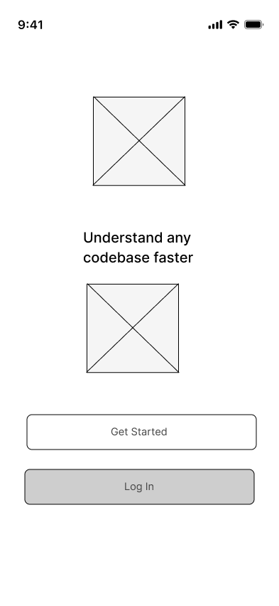
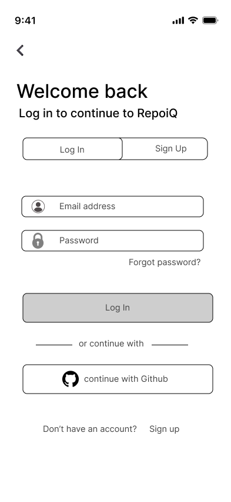
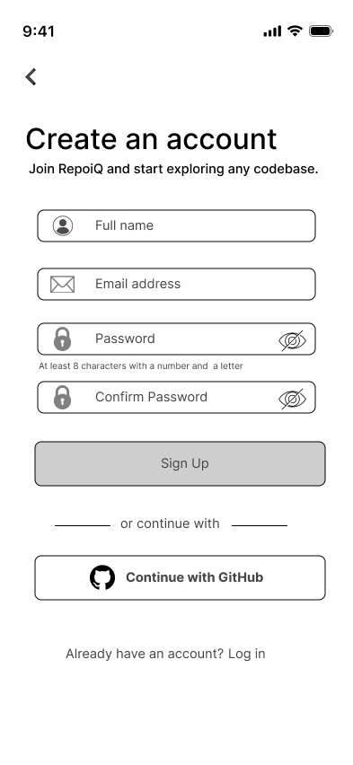
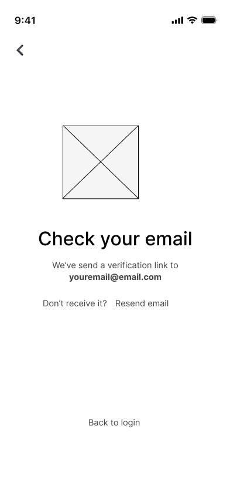
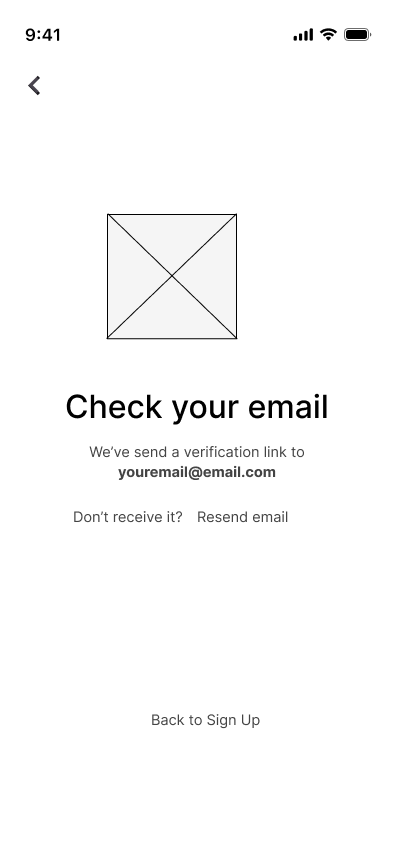
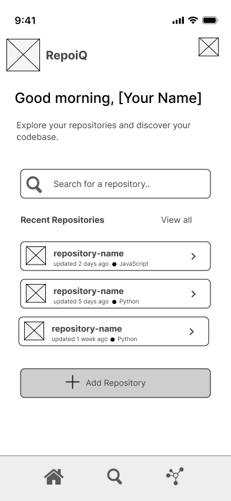
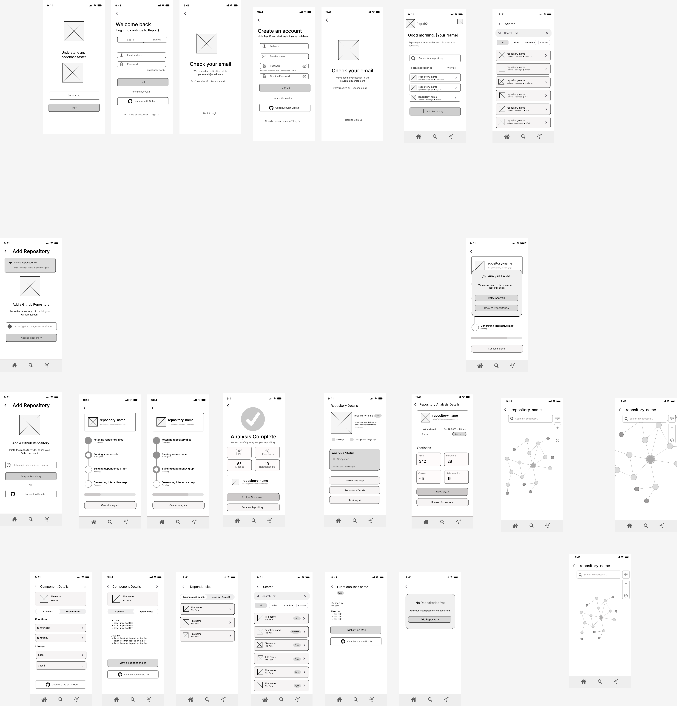

# RepoIQ UX Design

**RepoIQ** helps users understand a GitHub codebase through repository analysis, search, and an interactive code map.

## [Here](https://www.figma.com/design/KblWH70bD1B9II49iF0S8b/Wireframe?node-id=0-1&t=GFbFkCqHAO67KCcj-1) is the link to the Wireframe/Prototype Figma project. 

## [Here](https://www.figma.com/proto/KblWH70bD1B9II49iF0S8b/Wireframe?node-id=28-21&t=7PYAkJ2AfVD2TSsg-1&scaling=scale-down&content-scaling=fixed&page-id=0%3A1&starting-point-node-id=24%3A11&show-proto-sidebar=1) is the link to our prototype. 

## We split the work as follows
 ### App Map: Worked on it all together
 ### Wireframes (and linking as prototype): 
 #### Aditi (AditiAdhikari05): FirstScreen, Login, Signup, Email Verification (both), Home, Add Repository
 #### Asia (maomao274): Component Details, Dependency Details, Search Results (repository-level), Search Result Details, Empty States
 #### Mariam (st6rgazing): Add Repository (Error (using Asia's assets)), Analysis Progress (both), Analysis Results, Interactive Map (all versions), Search Results (user-level), Repository Details, Analysis Complete (and error)

## App map

The app map shows how the main screens connect.

## [Here](https://www.figma.com/board/L5Dv30LxFuzI3nT3Jmnupg/App-Map?node-id=0-1&t=pPUwhPhtwwRhPGwQ-1) is the link to the App Map Figma project. 

## Wireframes

The screens follow the journey from signing in to exploring a repository. Each image can be opened at full size. On signed-in screens, the bottom icons provide access to Home, Search, and the code map.

---

### Welcome and account access

#### Welcome

Introduces **RepoIQ**. **Get Started** opens sign-up. **Log In** takes returning users to login.

#### Log in

Users log in with email and password or continue with GitHub. They can also switch to sign-up or use **Forgot password**.

#### Sign up

New users enter their name, email, and password or sign up with GitHub. The eye icons show or hide passwords.

#### Check your email

Asks users to verify their email. They can resend the verification link or return to login.

#### Sign-up email verification

Shows the verification message after sign-up. You can resend the email or return to the sign-up form.

---

### Home and repositories

#### Home

Shows recent repositories, repository search, and **Add Repository**. Selecting a repository will go to repository details.

#### No repositories yet

This screen appears when there are no saved repositories. **Add Repository** links to the add repository screen 

#### Add a repository

Users paste a GitHub repository URL and select **Analyse Repository** or connect their GitHub account.

#### Invalid repository URL

Shows an error above the form so users can correct the URL and try again.

#### Repository details

Shows repository information and analysis status. Users can open the code map, view analysis details or run the analysis again.

---

### Repository analysis

#### Analysis in progress

Shows progress through fetching files, parsing code, building dependencies, generating the map. Users can cancel the analysis and that will lead them to an error screen.

#### Later analysis progress

Shows the same analysis further along with updated progress bar. Users can cancel the analysis and that will lead them to an error screen.

#### Analysis failed

Buttons **Retry Analysis** or **Back to Repositories** when analysis fails.

#### Analysis complete

Confirms success and summarizes files, functions, classes, and relationships. **Explore Codebase** links to the interactive map. **Remove Repository** removes the saved entry.

#### Analysis results

Shows the last analysis date, status, and statistics. Users can re-analyze or remove the repository.

---

### Interactive map

#### Code map

Displays code components and their relationships with search, filters, and zoom controls.

#### Zoomed out

Zooms out

#### Zoomed in

Zooms in

---

### Search

#### Repository search results

Lists matching repositories with their language and update information. Selecting a result opens the repository.

#### Code search results

Lists matching files, functions, and classes. The filter tabs will narrow results by type, date etc.

#### Search result details

Shows where a function or class is defined and used. **Highlight on Map** locates it in the graph and **View Source on GitHub** opens its Github remote.

---

### Components and dependencies

#### Component contents

Lists the functions and classes in a file. Users can press **Dependencies** or open the file on GitHub.

#### Component dependencies

Shows **Imports**, the files this component depends on, and **Used by** shows the files that depend on it. **View all dependencies** will show all

#### Dependency details

Lists related files under **Depends on** and **Used by**, with a count for each. Select a file to inspect it.

---

##  Prototype

The prototype brings the screens together to show the app's flow.

## [Here](https://www.figma.com/proto/KblWH70bD1B9II49iF0S8b/Wireframe?node-id=28-21&t=7PYAkJ2AfVD2TSsg-1&scaling=scale-down&content-scaling=fixed&page-id=0%3A1&starting-point-node-id=24%3A11&show-proto-sidebar=1) is the link to our prototype. 

## [Here](https://www.figma.com/design/KblWH70bD1B9II49iF0S8b/Wireframe?node-id=0-1&t=GFbFkCqHAO67KCcj-1) is the link to the Figma project. 
